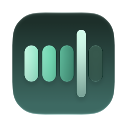

# Halt

Stops your MacBook charging where you choose, and shows where its power goes. By [Lveno](https://lveno.agency/).

## What it does

- Charge limit from 0 to 100%, top up, and discharge while plugged in
- Live power flow between the adapter, the battery and your Mac
- Heat protection, calibration and MagSafe light control
- Schedules, Shortcuts actions, keep awake and Low Power Mode
- Battery health, temperature and power history

## Requirements

An Apple silicon MacBook with macOS 27. So far Halt has only been tested on a MacBook Air (M4).

## Install

1. Download the disk image from [Releases](https://github.com/ayaanhaider-dev/halt/releases) and drag Halt to Applications.
2. Open Halt. macOS blocks it, because this release isn't notarized by Apple.
3. Go to System Settings → Privacy & Security and click **Open Anyway**.
4. Follow the setup. Halt asks for your password once, to install the helper that controls charging.

Halt checks GitHub once a day for a new version. You can turn that off in General. It sends nothing else.

## Good to know

- Halt uses private parts of macOS. An update from Apple can break it, so it refuses to set limits on anything but macOS 27.
- Above the limit, macOS drains the battery even while plugged in.
- macOS sometimes charges to 100% to calibrate itself, and Halt can't stop that.
- Quit any other charging app first.

## Remove

In General, click **Remove** next to the helper, then move Halt to the Trash.

## Build

You need Xcode 27 and an Apple Development certificate.

```
./dev.sh         # build and open
./dev.sh test    # run the tests
```

The app is in `Sources`, grouped by feature. `Helper` is the root service: it accepts only the commands in `Sources/Shared/HelperProtocol.swift`, and only from Halt. Format with `swift-format` before sending a change. Raise the version in `Helper/Info.plist` whenever the helper changes.

## Credits

[batt](https://github.com/charlie0129/batt) and Ampere worked out how charge limits behave on macOS 27.

## License

GPL-2.0. The Halt and Lveno names and logos are not covered by it.
